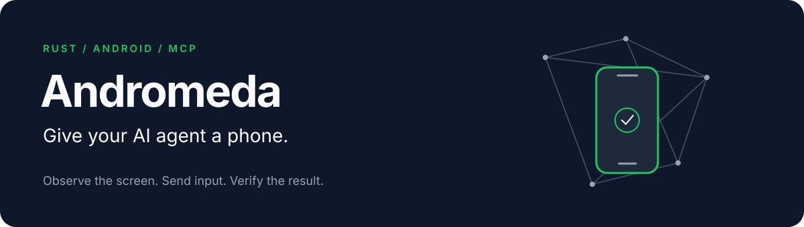

<p align="center"></p>

Andromeda gives MCP agents tools to observe and control an Android device. The server is written in Rust and talks directly to your local ADB server over USB or an explicitly authorized ADB connection.

[Add to Claude Code](docs/claude-code.md) · [Add to Codex](docs/codex.md) · [Other MCP clients](docs/clients.md) · [Tool reference](docs/api.md) · [Examples](docs/examples.md) · [Desktop setup](docs/desktop.md) · [Android companion](docs/companion.md)

**Development status:** the core server is implemented and undergoing device tests. The full release checklist is in [implementation-status.md](docs/implementation-status.md). Version `v0.1.0` has not been released.

## Desktop preview

The desktop app registers project directories, previews Codex/Claude MCP configuration, edits project instructions, and runs allowed tools automatically after you start a project. It includes device selection, an on-demand snapshot, an explicit live preview that runs until stopped, project-level Start, Pause/Resume and Stop, and a global emergency stop. See [desktop setup](docs/desktop.md) to build and run it. The [npm launcher](npm/README.md) resolves a local or platform desktop package; it has been tested against local builds, while published platform packages remain a release task.

## Run locally

Install [Android Platform Tools](https://developer.android.com/tools/releases/platform-tools) and Rust 1.88 or later. Enable USB debugging on a test phone, connect it, and accept its authorization prompt.

```sh
adb start-server
cargo install --path . --locked
andromeda devices
andromeda --device YOUR_SERIAL
```

The last command starts an MCP server on standard input/output. Your MCP client normally launches it. It can observe the phone by default. Add `--allow-control` when you want the session to send input.

```sh
codex mcp add andromeda -- andromeda --device YOUR_SERIAL --allow-control
claude mcp add --transport stdio andromeda -- andromeda --device YOUR_SERIAL --allow-control
```

See the [installation guide](docs/installation.md) for platform setup and troubleshooting.

## Observe, act, verify

Ask your agent to inspect the screen, perform a task, and check the result:

> Open Settings, find the display settings, and tell me whether dark mode is enabled. Ask before changing anything.

The agent receives an image or accessible UI nodes, chooses an action, then observes again. A successful tap means Android accepted the input; it does not prove the task succeeded.

| Capability | Tools |
| --- | --- |
| Observe | `adm_list_devices`, `adm_get_device_info`, `adm_get_view`, `adm_get_ui_tree`, `adm_list_apps` |
| Interact | `adm_touch`, `adm_touch_many`, `adm_swipe`, `adm_swipe_many`, `adm_press_key`, `adm_type_text` |
| Coordinate | `adm_multi_touch`, `adm_launch_app`, `adm_open_uri`, `adm_wait_for`, `adm_batch_actions`, `adm_get_long_view`, `adm_stop` |

Coordinates use native screen pixels, with `(0, 0)` at the top left of the current orientation. Capture results include dimensions and scale factors. Touch and swipe calls require observed geometry and reject a changed size or rotation.

## Performance and reliability

The device layer opens ADB services directly, without launching a host `adb` process for each tool call. Requests have deadlines and bounded output. `adm_stop` cancels active work, and failed input is never retried automatically. Screenshots support PNG, JPEG, lossy/lossless WebP and automatic compatible size selection. AVIF is an optional build feature for compatible clients/exports. The scrolling-view tool collects a bounded list scan; reobserve before using coordinates from earlier pages.

The capture, persistent-stream and input benchmark harness, plus Android 17 emulator and OnePlus physical baselines, are in [benchmarks](benchmarks/README.md). Matched open-source comparisons remain future work. There is no claim that Andromeda is the fastest Android MCP implementation.

## Control and privacy

Andromeda runs locally over stdio and only connects to a loopback ADB server. Select a device explicitly. Screenshots are returned to the client without being saved by the server. Accessibility inspection briefly uses a private file on the device and removes it after reading. The client may retain tool results in its conversation history.

Use client approval controls for purchases, financial transactions, messages, and other account-changing actions. Coordinate input cannot determine the meaning of the button underneath it. Protected screens may be blank, and some apps expose little accessible information. Follow each app's automation rules.

Read [SECURITY.md](SECURITY.md) before exposing a device to an agent.

## Develop

```sh
cargo fmt --check
cargo clippy --all-targets -- -D warnings
cargo test --all-targets
```

The reusable Rust device/controller library has no dependency on an AI vendor. See [CONTRIBUTING.md](CONTRIBUTING.md) and the [original specification](docs/intial_prompt.md) for scope and test expectations.

Original Andromeda code is available under MIT or Apache-2.0, at your option. Third-party dependencies retain their own licenses; see the [license review](docs/licenses.md).
